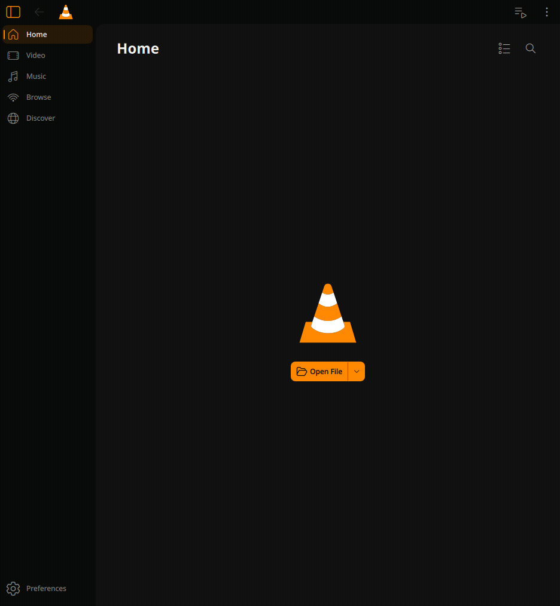
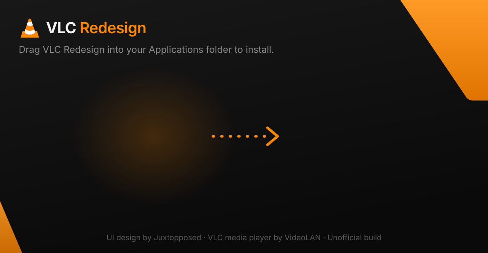
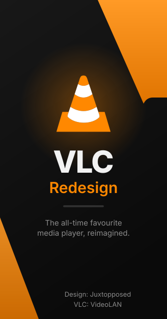

# VLC Redesign

<p align="center">
  
</p>

**VLC Redesign** is an unofficial fork of [VLC media player](https://www.videolan.org/vlc/)
whose interface is restyled after the design in
**[“I Redesigned VLC After 25 Years”](https://www.youtube.com/watch?v=ERFeOgqk324)
by [Juxtopposed](https://www.youtube.com/@juxtopposed)**.

> **Credits**
> - **Design:** Juxtopposed, from the video [“I Redesigned VLC After 25 Years”](https://www.youtube.com/watch?v=ERFeOgqk324).
>   Go watch it and support the channel.
> - **VLC media player:** the [VideoLAN](https://www.videolan.org) team and VLC's contributors.
>   Everything that makes this a media player is their work. This fork only changes how it looks.
>
> This project is not affiliated with or endorsed by VideoLAN or Juxtopposed.
> “VLC” and the cone logo are trademarks of the VideoLAN association.

<p align="center">
  
</p>

## Downloads

Grab the latest installers from **[Releases](../../releases)**:

| Platform | Package |
| --- | --- |
| Windows x64 | `Setup.exe` (NSIS with the dark redesign theme) and a portable `.zip` |
| macOS Apple Silicon (arm64) | `VLC Redesign.app`, which installs itself into Applications when first opened |
| macOS Intel (x86_64) | `VLC Redesign.app`, which installs itself into Applications when first opened |
| Linux x86_64 | `.AppImage` with a setup wizard; works even where AppImageLauncher crashes |

Builds are published for both **VLC 4.0** (development, `master`) and **VLC 3.0** (stable, `redesign-3.0` branch).

All of them are built by GitHub Actions ([`.github/workflows/build.yml`](.github/workflows/build.yml)).
The builds are unsigned, so see the first-launch notes in each release.

## What's changed from upstream VLC

Interface (Qt/QML, used on Windows and Linux):
- A new dark palette taken from the video: layered near-black surfaces (`#0A0A0A` → `#2F2F2F`),
  soft separators, and VLC orange (`#FF8800`) as the only accent
  ([`systempalette.cpp`](modules/gui/qt/style/systempalette.cpp)).
- Dark ("Night") is the default color scheme.
- Rounder corners on buttons, covers, nav items and the main view ([`VLCStyle.qml`](modules/gui/qt/style/VLCStyle.qml)).
- The play button is now a rounded-square orange tile with a black glyph, like in the video
  ([`PlayButton.qml`](modules/gui/qt/player/qml/controlbarcontrols/PlayButton.qml)).
- Sidebar: the current page gets an orange-tinted tile and indicator.
- Credits in *Help → About*.

macOS (native Cocoa interface):
- Always uses the dark appearance, with VLC orange as the accent instead of the system accent.
- Redesign tones for separators, slider tracks and borders; credits in *About VLC*.
- Ships as **VLC Redesign.app** with its own bundle id (`io.github.okjace.vlc-redesign`). Sparkle
  auto-update is disabled so it never "updates" itself back to official VLC.

Installers ([`redesign/branding`](redesign/branding)):
- **Windows:** dark welcome/finish pages with custom side art, a branded header and a custom welcome text
  and finish link. It installs side by side with official VLC (separate install dir, registry keys and
  Start-menu folder, and the uninstaller never touches VideoLAN's keys).
- **macOS:** like [Jace Launcher](https://github.com/okjace/jace-launcher), the download is just the `.app`. Opened
  from Downloads, it offers to copy itself into Applications, clear the quarantine flag ("damaged" warning),
  add Dock and Desktop shortcuts, and then relaunches the installed copy.
- **Linux:** like Jace Launcher, the AppImage opens a setup wizard (in the redesign style) that installs it to
  `~/Applications` with an applications-menu entry, desktop shortcut, `vlc-redesign` command and AppStream
  metadata. Launchers start it with `APPIMAGELAUNCHER_DISABLE=1`, and the AppImage magic bytes are cleared, so
  AppImageLauncher, which aborts on Wayland desktops such as niri, never intercepts it.

| DMG window | Windows installer |
| --- | --- |
|  |   |

To regenerate the artwork, run `redesign/branding/generate.py --font-dir <dir with Inter .ttf>`.

## Building locally

- Linux: `redesign/ci/build-linux.sh` (Ubuntu 24.04)
- macOS: `redesign/ci/build-macos.sh arm64` or `x86_64`
- Windows: cross-compiled in VideoLAN's `vlc-debian-win64-posix` Docker image with
  `extras/package/win32/build.sh -a x86_64 -p -r`

This fork is based on upstream commit [`429df92c508f98038ac992772fea1fec1322c9f9`](https://code.videolan.org/videolan/vlc/-/commit/429df92c508f98038ac992772fea1fec1322c9f9)
(VLC 4.0 development branch). It is recorded in [`redesign/UPSTREAM_COMMIT`](redesign/UPSTREAM_COMMIT).

---

*The original VLC README follows.*

# VLC media player

**VLC** is a libre and open source **media player** and **multimedia engine**,
focused on **playing everything**, and **running everywhere**.

**VLC** can play most multimedia files, discs, streams, devices and is also able to
convert, encode, **stream** and manipulate streams into numerous formats.

VLC is used by many over the world, on numerous platforms, for very different use cases.

The **engine of VLC** can be embedded into 3rd party applications, and is called *libVLC*.

**VLC** is part of the [VideoLAN project](https://videolan.org) and
is developed and supported by a community of volunteers.

The VideoLAN project was started at the university [École Centrale Paris](https://www.centralesupelec.fr/) who
relicensed VLC under the GPLv2 license in February 2001. Since then, VLC has
been downloaded **billions** of times.

## License

**VLC** is released under the GPLv2 *(or later)* license.
*On some platforms, it is de facto GPLv3, because of the licenses of dependencies*.

**libVLC**, the engine is released under the LGPLv2 *(or later)* license. \
This allows embedding the engine in 3rd party applications, while letting them to be licensed under other licenses.

# Platforms

VLC is available for the following platforms:
- [Windows] *(from 7 and later, including UWP platforms and all versions of Windows 10)*
- [macOS] *(10.10 and later)*
- [GNU/Linux] and affiliated
- [BSD] and affiliated
- [Android] *(4.2 and later)*, including Android TV and Android Auto
- [iOS] *(9 and later)*, including AppleTV and iPadOS
- Haiku, OS/2 and a few others.

[Windows]: https://www.videolan.org/vlc/download-windows.html
[macOS]: https://www.videolan.org/vlc/download-macosx.html
[GNU/Linux]: https://www.videolan.org/vlc/#download
[BSD]: https://www.videolan.org/vlc/download-freebsd.html
[Android]: https://www.videolan.org/vlc/download-android.html
[iOS]: https://www.videolan.org/vlc/download-ios.html

Not all platforms receive the same amount of care, due to our limited resources.

**Nota Bene**: The [Android app](https://code.videolan.org/videolan/vlc-android/) and
the [iOS app](https://code.videolan.org/videolan/vlc-ios/) are located in different repositories
than the main one.

# Contributing & Community

**VLC** is maintained by a community of people, and VideoLAN is not paying any of them.\
The community is composed of developers, helpers, maintainers, designers and writers that want
this open source project to thrive.

The main development of VLC is done in the C language, but this repository also contains
plenty of C++, Obj-C, asm and Rust.

Other repositories linked to vlc are done in languages including Kotlin/Java [(Android)](https://code.videolan.org/videolan/vlc-android/),
Swift [(iOS)](https://code.videolan.org/videolan/vlc-ios/), and C# [(libVLCSharp)](https://code.videolan.org/videolan/libvlcsharp/).

We need help with the following tasks:
- Coding
- Packaging for Windows, macOS and Linux distributions
- Technical writing for the documentation
- Design
- Support
- Community management and communication.

Please contribute :)

We are on IRC. You can find us on the **#videolan** channel on *[Libera.chat]*.

[Libera.chat]: https://libera.chat

## Contributions

Contributions are now done through Merge Requests on our [GitLab repository](https://code.videolan.org/videolan/vlc/).

CI and discussions should be resolved before a Merge Request can be merged.

# libVLC

**libVLC** is an embeddable engine for 3rd party applications and frameworks.

It runs on the same platforms as VLC *(and sometimes on more)* and can provide playback,
streaming and conversion of multimedia files and streams.


**libVLC** has numerous bindings for other languages, such as C++, Python and C#.

# Support

## Links

Some useful links that might help you:

- [VLC web site](https://www.videolan.org/vlc/)
- [Support](https://www.videolan.org/support/)
- [Forums](https://forum.videolan.org/)
- [Wiki](https://wiki.videolan.org/)
- [Developer's Corner](https://wiki.videolan.org/Developers_Corner)
- [VLC hacking guide](https://wiki.videolan.org/Hacker_Guide)
- [Bugtracker](https://code.videolan.org/videolan/vlc/-/issues)
- [VideoLAN web site](https://www.videolan.org/)

## Source Code sitemap
```
ABOUT-NLS          - Notes on the Free Translation Project.
AUTHORS            - VLC authors.
COPYING            - The GPL license.
COPYING.LIB        - The LGPL license.
INSTALL            - Installation and building instructions.
NEWS               - Important modifications between the releases.
README             - Project summary.
THANKS             - VLC contributors.

bin/               - VLC binaries.
bindings/          - libVLC bindings to other languages.
compat/            - compatibility library for operating systems missing
                     essential functionalities.
contrib/           - Facilities for retrieving external libraries and building
                     them for systems that don't have the right versions.
doc/               - Miscellaneous documentation.
extras/analyser    - Code analyser and editor specific files.
extras/buildsystem - Different build system specific files.
extras/misc        - Files that don't fit in the other extras/ categories.
extras/package     - VLC packaging specific files such as spec files.
extras/tools/      - Facilities for retrieving external building tools needed
                     for systems that don't have the right versions.
include/           - Header files.
lib/               - libVLC source code.
modules/           - VLC plugins and modules. Most of the code is here.
po/                - VLC translations.
share/             - Common resource files.
src/               - libvlccore source code.
test/              - Testing system.
```
