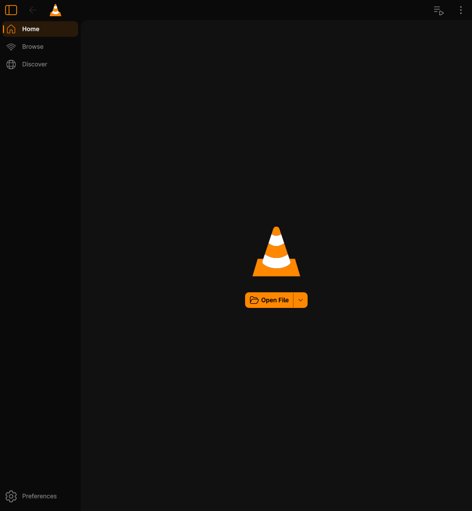
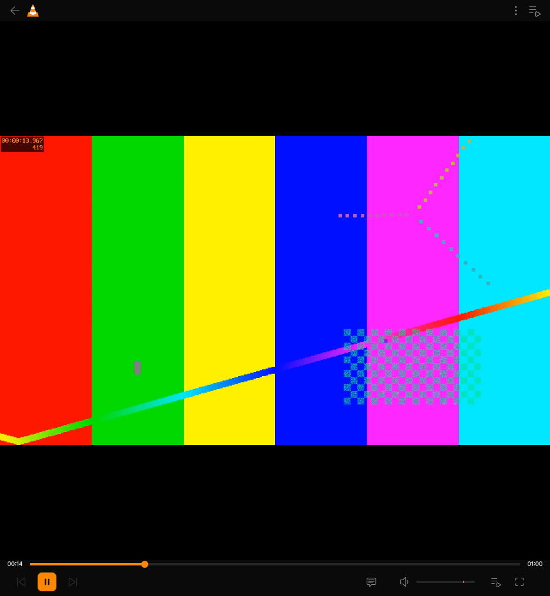
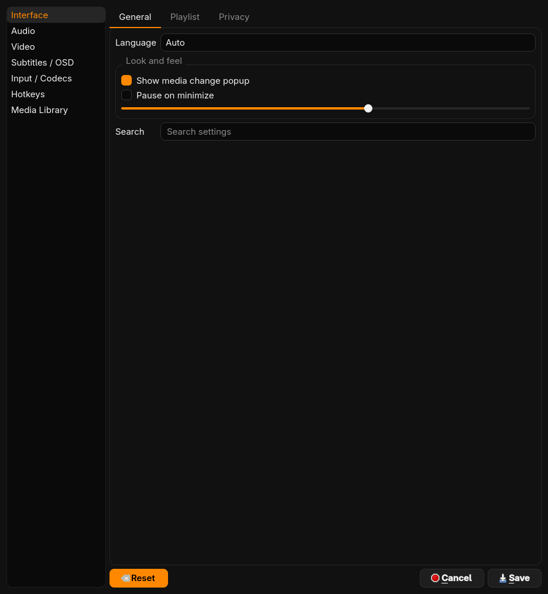

# VLC — redesigned

<p align="center">
  
</p>

An unofficial build of **[VLC media player](https://www.videolan.org/vlc/)** with its interface redesigned after
**[“I Redesigned VLC After 25 Years”](https://www.youtube.com/watch?v=ERFeOgqk324) by [Juxtopposed](https://www.youtube.com/@juxtopposed)**.
It's simply called **VLC**, and it installs side by side with VideoLAN's VLC without touching it.

> **Credits**
> - **Design:** Juxtopposed, from the video [“I Redesigned VLC After 25 Years”](https://www.youtube.com/watch?v=ERFeOgqk324).
> - **VLC media player:** the [VideoLAN](https://www.videolan.org) team and VLC's contributors. Everything that makes
>   this a media player is their work; this project only changes how it looks.
>
> Not affiliated with or endorsed by VideoLAN or Juxtopposed. “VLC” and the cone logo are trademarks of the VideoLAN association.

| Home | Player | Dialogs |
| --- | --- | --- |
|  |  |  |

## Download

Get the latest installers from **[Releases](../../releases/latest)**. Like [Jace Launcher](https://github.com/okjace/jace-launcher),
each one installs itself:

| Platform | File | How it installs |
| --- | --- | --- |
| Windows x64 | `VLC-<version>-Windows-x64-Setup.exe` | Dark setup wizard; also a portable `.zip` |
| macOS Apple Silicon / Intel | `VLC-<version>-macOS-<arch>.app.zip` | Open `VLC.app`: it moves itself into Applications, adds Dock and Desktop shortcuts and clears the "damaged" warning |
| Linux x86_64 | `VLC-<version>-Linux-x86_64.AppImage` | Double-click: a setup wizard installs it to `~/Applications` with a menu entry, desktop shortcut and `vlc-redesign` command |

The builds aren't signed. On macOS, right-click → **Open** the first time; on Windows, SmartScreen → **More info** → **Run anyway**.

## What's redesigned (VLC 4.0)

- **Look:** layered near-black surfaces with VLC orange (`#FF8800`) as the only accent; dark by default; rounder corners
  everywhere; [Inter](https://rsms.me/inter) as the typeface (bundled, SIL OFL).
- **Player bar:** one compact bar pinned under the video: time, an orange seek bar and the remaining time on one line;
  previous / an orange play tile / next on the left; tracks, speed, volume, playlist, fullscreen and menu on the right.
- **Sidebar:** the current page sits on an orange-tinted tile with an orange indicator.
- **Dialogs and menus:** Preferences, Open Media, right-click menus and tooltips use the same dark, rounded,
  orange-accent theme instead of the system look.
- **macOS:** dark appearance and VLC orange accent in the native interface.
- **Installers:** self-installing apps on every platform, with matching artwork (`redesign/branding/generate.py`).

Builds run on GitHub Actions ([`.github/workflows/build.yml`](.github/workflows/build.yml)); push a `v*` tag to publish a release.

This repository is a snapshot of VLC upstream commit [`429df92c5`](https://code.videolan.org/videolan/vlc/-/commit/429df92c508f98038ac992772fea1fec1322c9f9)
(VLC 4.0 development branch) plus the redesign. The VLC 3.0.24 version lives in
[okjace/vlc](https://github.com/okjace/vlc/tree/redesign-3.0).

---

*The original VLC README follows.*

# VLC media player

**VLC** is a libre and open source **media player** and **multimedia engine**,
focused on **playing everything**, and **running everywhere**.

**VLC** can play most multimedia files, discs, streams, devices and is also able to
convert, encode, **stream** and manipulate streams into numerous formats.

VLC is used by many over the world, on numerous platforms, for very different use cases.

The **engine of VLC** can be embedded into 3rd party applications, and is called *libVLC*.

**VLC** is part of the [VideoLAN project](https://videolan.org) and
is developed and supported by a community of volunteers.

The VideoLAN project was started at the university [École Centrale Paris](https://www.centralesupelec.fr/) who
relicensed VLC under the GPLv2 license in February 2001. Since then, VLC has
been downloaded **billions** of times.

## License

**VLC** is released under the GPLv2 *(or later)* license.
*On some platforms, it is de facto GPLv3, because of the licenses of dependencies*.

**libVLC**, the engine is released under the LGPLv2 *(or later)* license. \
This allows embedding the engine in 3rd party applications, while letting them to be licensed under other licenses.

# Platforms

VLC is available for the following platforms:
- [Windows] *(from 7 and later, including UWP platforms and all versions of Windows 10)*
- [macOS] *(10.10 and later)*
- [GNU/Linux] and affiliated
- [BSD] and affiliated
- [Android] *(4.2 and later)*, including Android TV and Android Auto
- [iOS] *(9 and later)*, including AppleTV and iPadOS
- Haiku, OS/2 and a few others.

[Windows]: https://www.videolan.org/vlc/download-windows.html
[macOS]: https://www.videolan.org/vlc/download-macosx.html
[GNU/Linux]: https://www.videolan.org/vlc/#download
[BSD]: https://www.videolan.org/vlc/download-freebsd.html
[Android]: https://www.videolan.org/vlc/download-android.html
[iOS]: https://www.videolan.org/vlc/download-ios.html

Not all platforms receive the same amount of care, due to our limited resources.

**Nota Bene**: The [Android app](https://code.videolan.org/videolan/vlc-android/) and
the [iOS app](https://code.videolan.org/videolan/vlc-ios/) are located in different repositories
than the main one.

# Contributing & Community

**VLC** is maintained by a community of people, and VideoLAN is not paying any of them.\
The community is composed of developers, helpers, maintainers, designers and writers that want
this open source project to thrive.

The main development of VLC is done in the C language, but this repository also contains
plenty of C++, Obj-C, asm and Rust.

Other repositories linked to vlc are done in languages including Kotlin/Java [(Android)](https://code.videolan.org/videolan/vlc-android/),
Swift [(iOS)](https://code.videolan.org/videolan/vlc-ios/), and C# [(libVLCSharp)](https://code.videolan.org/videolan/libvlcsharp/).

We need help with the following tasks:
- Coding
- Packaging for Windows, macOS and Linux distributions
- Technical writing for the documentation
- Design
- Support
- Community management and communication.

Please contribute :)

We are on IRC. You can find us on the **#videolan** channel on *[Libera.chat]*.

[Libera.chat]: https://libera.chat

## Contributions

Contributions are now done through Merge Requests on our [GitLab repository](https://code.videolan.org/videolan/vlc/).

CI and discussions should be resolved before a Merge Request can be merged.

# libVLC

**libVLC** is an embeddable engine for 3rd party applications and frameworks.

It runs on the same platforms as VLC *(and sometimes on more)* and can provide playback,
streaming and conversion of multimedia files and streams.


**libVLC** has numerous bindings for other languages, such as C++, Python and C#.

# Support

## Links

Some useful links that might help you:

- [VLC web site](https://www.videolan.org/vlc/)
- [Support](https://www.videolan.org/support/)
- [Forums](https://forum.videolan.org/)
- [Wiki](https://wiki.videolan.org/)
- [Developer's Corner](https://wiki.videolan.org/Developers_Corner)
- [VLC hacking guide](https://wiki.videolan.org/Hacker_Guide)
- [Bugtracker](https://code.videolan.org/videolan/vlc/-/issues)
- [VideoLAN web site](https://www.videolan.org/)

## Source Code sitemap
```
ABOUT-NLS          - Notes on the Free Translation Project.
AUTHORS            - VLC authors.
COPYING            - The GPL license.
COPYING.LIB        - The LGPL license.
INSTALL            - Installation and building instructions.
NEWS               - Important modifications between the releases.
README             - Project summary.
THANKS             - VLC contributors.

bin/               - VLC binaries.
bindings/          - libVLC bindings to other languages.
compat/            - compatibility library for operating systems missing
                     essential functionalities.
contrib/           - Facilities for retrieving external libraries and building
                     them for systems that don't have the right versions.
doc/               - Miscellaneous documentation.
extras/analyser    - Code analyser and editor specific files.
extras/buildsystem - Different build system specific files.
extras/misc        - Files that don't fit in the other extras/ categories.
extras/package     - VLC packaging specific files such as spec files.
extras/tools/      - Facilities for retrieving external building tools needed
                     for systems that don't have the right versions.
include/           - Header files.
lib/               - libVLC source code.
modules/           - VLC plugins and modules. Most of the code is here.
po/                - VLC translations.
share/             - Common resource files.
src/               - libvlccore source code.
test/              - Testing system.
```
